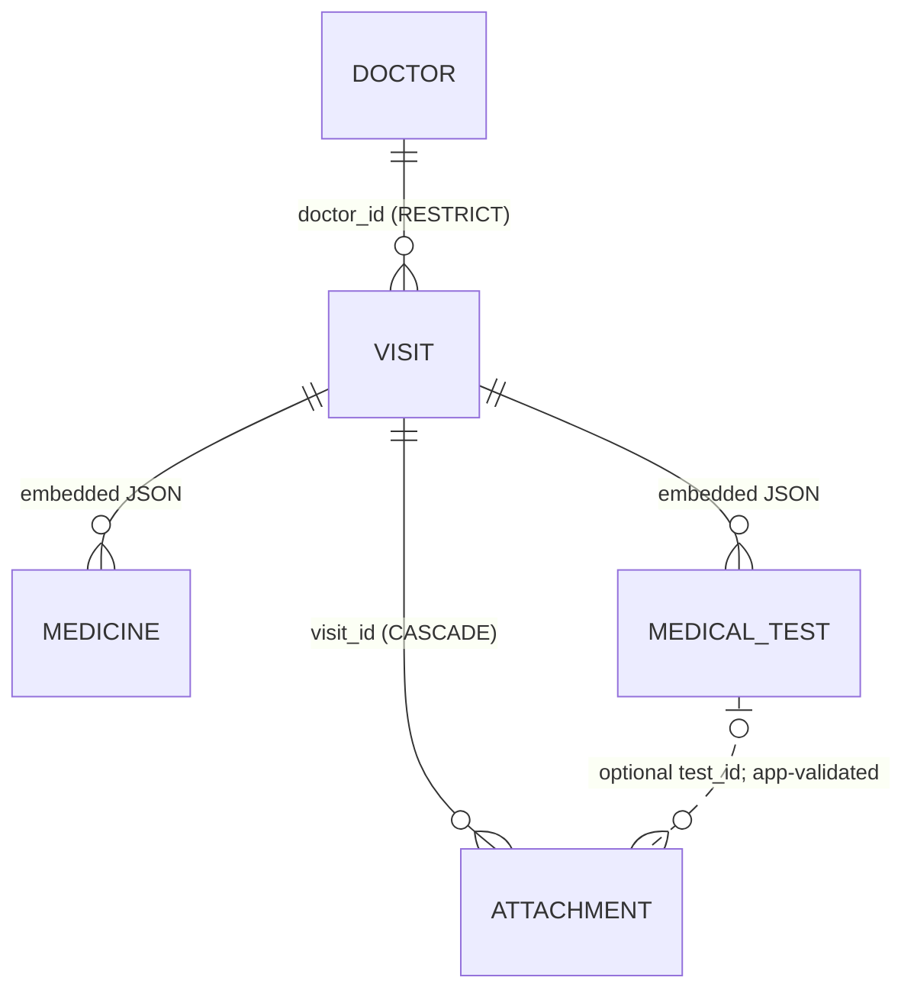

# My Medical History — Existing Implementation Audit

**Audit phase:** Phase 0, Steps 0.1–0.3 consolidated  
**Source snapshot:** `my_medical_history-main.zip` (uploaded repository archive)  
**Audit status:** Source reviewed; selected workflows user-verified on a physical Android device; automated suite not executed in this audit.  
**Purpose:** Baseline for Codex-assisted incremental work, **not** a replacement architecture or authorization to refactor.

## 1. Audit Scope and Evidence

Evidence includes the uploaded Flutter source archive, source-level inspection of Dart implementation, and the user's 16-scenario Android checklist. “Source-confirmed” means implementation exists in the snapshot, **not** that it passed execution. “Device-observed” means the user tested the named behavior. “Unverified” means no sufficient execution evidence. The earlier audit's conclusions are reconciled with the source where possible. No code was modified; no Flutter build, analyzer, automated tests, or migration test was executed here. The Stitch design exports are reference material, not evidence of runtime implementation.

## 2. Repository Overview

Relevant repository layout (paths relative to repository root):

```text
android/ ios/ linux/ macos/ web/ windows/
lib/
  main.dart
  app.dart
  domain/records.dart
  domain/history_filter.dart
  data/medical_repository.dart
  data/sqlite_medical_repository.dart
  state/medical_store.dart
  services/attachment_files.dart
  services/attachment_gateway.dart
  services/connections.dart
  ui/actions.dart
  ui/attachments.dart
  ui/forms/doctor_form.dart
  ui/forms/visit_form.dart
  ui/history_filter_sheet.dart
  ui/screens/{home_screen,doctors_screen,history_screen,reports_screen,settings_screen,doctor_details,visit_details}.dart
  ui/theme.dart
  ui/widgets.dart
test/{history_filter_test,sqlite_repository_test,widget_test,medical_store_test,journal_ui_test,attachment_storage_test}.dart
test/support/{sqlite_probe,core_flow,memory_repository}.dart
integration_test/{attachment_fixture,restart_test,core_flow_test}.dart
design_reference/stitch_my_medical_history_mobile_v1/
pubspec.yaml pubspec.lock analysis_options.yaml README.md
```

The presence of test files is verified; successful execution is not. README references to any other audit document should not be treated as proof that such a document is present in this archive.

## 3. Current Flutter Architecture

- `lib/main.dart`: startup/bootstrap, opening persistence and loading application state.
- `lib/app.dart`: `MedicalApp`, `MedicalShell`, `MaterialApp`, five `NavigationBar` destinations and an `IndexedStack`.
- `lib/ui/`: screens, detail views, forms, common widgets, themes, filter UI and attachment actions.
- `lib/state/medical_store.dart`: `MedicalStore extends ChangeNotifier`; owns in-memory lists and coordinates mutations.
- `lib/data/medical_repository.dart`: `MedicalRepository` contract and `MedicalRecords` loaded snapshot.
- `lib/data/sqlite_medical_repository.dart`: `SqliteMedicalRepository implements MedicalRepository` and SQL transactions.
- `lib/domain/records.dart`: domain records and mapping/JSON serialization.
- `lib/services/`: local file management, file selection/gateway, and optional connection-service interfaces.

Current flow: **UI → MedicalStore → MedicalRepository → SQLite**, with `AttachmentFiles` used for physical file operations. This is a pragmatic separation for the present local-first application. Do not replace state management or persistence solely for architectural fashion. The `IndexedStack` preserves tab-local state, including active History filters.

## 4. Domain Models and Relationships

Defined in `lib/domain/records.dart`:

| Class | Fields / role | Persistence |
|---|---|---|
| `Doctor` | `id`, `name`, `specialty`, `facility`, `phone` | `doctors` row |
| `Visit` | `id`, `doctorId`, `date`, `reason`, `diagnosis`, `notes`, `facility`, nullable `followUp`, lists of medicines/tests | `visits` row |
| `Medicine` | `name`, `instructions` | JSON element in `visits.medicines` |
| `MedicalTest` | `id`, `name`, `result` | JSON element in `visits.tests` |
| `Attachment` | `id`, `visitId`, nullable `testId`, original `name`, generated `storedName`, `mimeType`, `size`, `createdAt` | `attachments` row plus private file |



The medicine/test boxes in this conceptual ER diagram **are not SQLite tables**. `MedicalTest.id` is generated for legacy entries missing IDs using `legacy:<visitId>:<index>` in the `Visit` constructor. Preserve test IDs on edit to avoid breaking attachment associations.

## 5. SQLite Schema and Migrations

`SqliteMedicalRepository.open()` uses database filename `medical_history.db`, schema **version 2**, and `PRAGMA foreign_keys = ON` in `onConfigure`.

- `doctors`: `id TEXT PRIMARY KEY`; required `name`, `specialty`, `facility`, `phone`.
- `visits`: `id TEXT PRIMARY KEY`; `doctor_id TEXT NOT NULL REFERENCES doctors(id) ON DELETE RESTRICT`; required date, reason, diagnosis, notes, facility, medicines JSON, tests JSON; nullable `follow_up` (v2). Index `visits_doctor_date` on `(doctor_id, date DESC)`.
- `attachments` (v2): `id TEXT PRIMARY KEY`; `visit_id TEXT NOT NULL REFERENCES visits(id) ON DELETE CASCADE`; nullable `test_id TEXT`; required `name`, `stored_name TEXT UNIQUE`, `mime_type`, `size`, `created_at`. Index `attachments_visit`.
- `file_deletions` (v2): `stored_name TEXT PRIMARY KEY`, durable queue for file cleanup.

`onCreate` creates doctors/visits/index then calls `_addVersion2()`. `onUpgrade` invokes `_addVersion2()` for `oldVersion < 2`, adding `follow_up`, `attachments`, attachment index and deletion queue. The migration is designed as additive and avoids rewriting existing clinical records. **Migration execution and compatibility with a real v1 database remain unverified.** Dates are ISO-8601 text, and medicine/test contents are JSON text; SQLite cannot enforce their semantic validity or internal references.

## 6. State Management and Data Flows

`MedicalStore` maintains `_doctors`, `_visits`, `_attachments`, exposes unmodifiable list getters and selectors (`doctor`, `visit`, `visitsFor`, `attachmentsFor`), and calls `notifyListeners()` on load and writes. `MedicalStore.newId()` generates 16 cryptographically random bytes as a hex identifier. `busy` and `_write(persist, apply)` serialize store-mediated writes: persist first, then apply to memory, sort, attempt file cleanup, and notify in `finally`.

- **Load:** `MedicalStore.load()` → `MedicalRepository.load()` → transaction querying doctors, visits, attachments → populate/sort lists → notify → retry queued deletions.
- **Doctor upsert:** `saveDoctor()` checks nonblank name → repository `saveDoctor()` → SQLite transaction `_upsert()` → replace in-memory record.
- **Visit upsert:** `saveVisit()` checks doctor exists in store and reason is nonblank → repository `saveVisit()` upserts JSON-serialized visit and reconciles attachments to removed tests → store updates visit and attachment associations.
- **Doctor delete:** `deleteDoctor()` rejects doctor with linked visits; SQLite also restricts deletion.
- **Visit delete:** `deleteVisit()` queues filenames, deletes visit; foreign key cascades attachment metadata; store removes related records and attempts physical cleanup.
- **Attachment add/remove:** `addAttachment()` imports bytes, creates metadata, repository validates visit/test, inserts record; `removeAttachment()` queues filename and removes metadata, then cleanup runs.

An error after a committed SQL write but before successful in-memory reconciliation is a theoretical state-consistency risk; no device failure was observed. The busy flag is local to one `MedicalStore` instance, not a database-wide concurrency primitive.

## 7. Existing Screens and Features

`lib/app.dart` defines five tabs: **Home**, **Doctors**, **History**, **Reports**, **Settings**. Detail/form screens include `doctor_details.dart`, `visit_details.dart`, `doctor_form.dart`, and `visit_form.dart`.

| Screen / feature | Source implementation | Device evidence / caveat |
|---|---|---|
| Home | Counts, recent information, nearest upcoming follow-up, shortcuts | Navigation tested; overdue/multiple follow-up behavior not fully tested |
| Doctors | List, search, add, edit, detail, deletion | Create/edit/search passed |
| History | Visit list, search, filters, detail and visit creation | Filters passed; search returns results but matching text not surfaced/highlighted |
| Visit form/detail | Doctor, date, reason, notes, diagnosis, facility, medicines, tests, follow-up; edit/delete | Create/edit, medicine/test entry, required-field validation, visit deletion passed |
| Reports | Test/report listing and attachment-related actions | A03 failed UX expectation: filenames dominate clinical labels |
| Settings | Storage and account/backup status | Connection integrations not operational |
| Attachments | PDF/image import, open, remove, optional test association | Import/open passed; full cleanup lifecycle unverified |

`HistoryFilter` lives in `lib/domain/history_filter.dart`; UI filters in `lib/ui/history_filter_sheet.dart`. Persistent filters after switching tabs are consistent with `IndexedStack`, but the active-filter state should be obvious. Home currently selects a single nearest future follow-up; overdue dates are excluded from its upcoming set (source-audit finding). These are product/UX decisions rather than evidence of lost data.

## 8. Attachment Storage and File Lifecycle

Key locations: `lib/services/attachment_files.dart`, `lib/services/attachment_gateway.dart`, `lib/ui/attachments.dart`, `lib/state/medical_store.dart`, `lib/data/sqlite_medical_repository.dart`.

- Import accepts PDF, JPEG, PNG and WebP, validates signatures and applies a 25 MB size limit (source finding).
- Physical bytes are copied into app-private storage under a generated relative `storedName`, not the original picker path. `Attachment.name` retains the display/original name.
- `Attachment.visitId` is mandatory. `Attachment.testId` is optional and checked in `SqliteMedicalRepository.saveAttachment()` against the tests decoded from the linked visit.
- If a test is removed from a visit, `saveVisit()` clears affected attachment `test_id` values **without deleting the files**. `Attachment.atVisit()` performs the equivalent in-memory conversion.
- Deleting an attachment or visit writes stored filenames to `file_deletions` inside a transaction, then deletes attachment metadata (directly or by visit cascade).
- `MedicalStore.cleanRemovedFiles()` retries filesystem deletion on startup and subsequent writes; failed deletions stay queued. This is a reasonable solution to the absence of atomic cross-resource SQL/filesystem transactions.
- If SQL metadata insertion fails after file import, `addAttachment()` attempts to remove the newly imported file before rethrowing.

**Unverified:** cleanup after interrupted operations, permissions/open behavior across Android versions, file orphan detection, storage exhaustion and corrupt-file handling. A successful Android attachment import/open was reported; it does not prove all lifecycle edge cases.

## 9. Doctor–Hospital–Visit Relationships

`Doctor.facility` is the doctor's default/associated workplace, **not** a normalized facility foreign key. `Visit.facility` is a historical snapshot of where a particular encounter occurred. `lib/ui/forms/visit_form.dart` initially takes the existing visit facility or selected doctor's facility, but permits editing the visit's facility independently. Therefore a doctor can have visits recorded at different locations without changing earlier visits.

**Keep this distinction.** Free-text names can vary (`City Hospital` vs `City Hosp.`), and there is no facility catalog, many-to-many doctor/facility table, or canonical facility ID. This limits reuse and facility-based reporting, but it is not itself a bug. A select-or-add facility UX or normalized facility model is a later product/data-model decision requiring requirements and migration planning; do not silently overwrite historical visit locations.

## 10. Data Integrity and Deletion Safeguards

**Enforced by SQLite:** doctor and visit primary keys, visit→doctor foreign key with `RESTRICT`, attachment→visit foreign key with `CASCADE`, unique attachment stored filename, required columns. **Enforced in application logic:** doctor name and visit reason validation, doctor existence check, test association validation, cleanup of stale test links, prevention of deleting doctors with visits. **Not relationally enforced:** `test_id` points to an embedded JSON test, medicine/test field semantics, normalized facility identity.

`MedicalStore.deleteDoctor()` throws when `visitsFor(id)` is nonempty, and SQLite independently protects linked visits. User observed this protective behavior, so P03 is **partially verified**, not an unconditional pass. Deleting a disposable visit passed on device; durable physical file cleanup was not separately confirmed.

## 11. Known Bugs and Architectural Risks

| ID | Finding | Evidence classification | Implication |
|---|---|---|---|
| UX-01 | Reports emphasizes opaque file names instead of clinical test names | Device-observed failure A03 + screen review | Poor report discoverability; check actual test association before relabeling |
| UX-02 | History results do not reveal/highlight matching text | Device observation H01; retrieval appears functional | Search explanation/visibility issue; not proven retrieval failure |
| UX-03 | Filters remain after tab navigation | Device-observed; explained by `IndexedStack` | May surprise users unless active filters are visible |
| UX-04 | Only nearest upcoming follow-up shown; overdue excluded | Source finding | Potentially hidden actionable follow-ups |
| DATA-01 | `Attachment.testId` has no SQL FK | Source-confirmed | Must preserve repository validation and edit reconciliation |
| DATA-02 | Test identity stability during edit is essential | Source-confirmed model and link design | Regression risk if test IDs regenerated |
| DATA-03 | Medicines/tests serialized as JSON | Source-confirmed | Limited SQL querying/constraints; sync/reporting harder later |
| DATA-04 | Facility is free text in doctor and visit | Source-confirmed | Inconsistent naming; no shared facility identity |
| OPS-01 | File operations and SQL cannot commit atomically | Source-confirmed architecture | Durable deletion queue mitigates; edge cases untested |
| STATE-01 | SQL save and in-memory update are separate stages | Source-confirmed | Failure after commit may require reload to reconcile |

Do not label UX-02 as a broken search algorithm without a failed matching/nonmatching test. Do not label retained filters or visit-specific facility editing as definite defects without a product policy.

## 12. Security and Privacy Assessment

**Present:** SQLite stored in application-managed database path; attachments copied into private app storage with generated names; signature/type and size checks; foreign-key safeguards; deletion queue; unconfigured connection services do not imply active cloud upload. **Limitation:** No additional application-level encryption of SQLite medical data or stored attachments was established in the reviewed persistence components. Private app storage is not equivalent to application-managed encryption. Authentication, cloud synchronization, Google Drive backup/restore, access control, recovery, and retention policies are not operationally established in this snapshot. Treat all records as sensitive. Use synthetic demonstration data only; never place patient records, API secrets, keystores or production credentials in Codex prompts or commits. A future security review must examine OS backup configuration, logs, exported components, local access, threat model, and encryption/recovery trade-offs.

## 13. Verified vs. Unverified Functionality

**User device-verified passes (13/16):** D01 create doctor, D02 edit doctor, D03 doctor search; V01 create visit, V02 edit visit, V03 medicines/tests, V04 validation; A01 attach file, A02 open attachment; H02 filters, H03 navigation; P01 app restart/persistence, P02 delete visit.

**Reported failures (2/16):** A03 Reports presentation/discoverability; H01 search-result explanation/highlighting. H01 is **not proof that retrieval itself is wrong**.

**Initially untested (1/16):** P03 delete doctor with visits; user subsequently observed a block/message protecting linked visits. Record as partially verified, not fully tested.

**Source-present, not execution-verified here:** SQL schema upgrade, transactional reconciliation of test attachments, cleanup retry behavior, tests and integration test suites, sync/backup interface behavior, every edge-case validation path. The app launched on a physical Android device according to the user; no automated Android instrumentation result is claimed.

## 14. Recommended Implementation Priorities

### Keep

- Existing `ChangeNotifier`/`MedicalStore` and repository boundary; versioned SQLite; transactional persistence.
- Doctor deletion restriction; attachment→visit cascade with durable file-deletion queue.
- Visit-specific facility snapshot; retention of files when a test is removed.
- Core doctor/visit CRUD, local search/filter and local persistence workflows verified by the user.

### Fix Before Friday (prefer low-risk changes and tests)

1. Establish a stable demonstration baseline with synthetic doctor, visit, test, PDF/image, search and restart scenario; avoid schema changes.
2. Clarify Reports presentation: clinical test name prominent where linkage is valid, original filename secondary; inspect `reports_screen.dart` and attachment/test associations before editing.
3. Improve History search result explanation (matching excerpt/highlight) if safe; preserve existing matching behavior.
4. Verify test edit/removal attachment preservation and deletion cleanup; inspect overdue follow-up behavior and explain limitations during review.
5. Run `flutter analyze`, relevant `flutter test` and integration tests on an appropriately configured development machine; record exact results, not assumptions.

### Improve Later

- Canonical facilities / select-or-add UX, possibly doctor↔facility relationships after requirements analysis.
- Normalized test/medicine storage if advanced querying, syncing or analytics justify migration.
- Stronger medical-data encryption, access control, backup/restore and recovery strategy.
- Multi-item/overdue follow-up presentation, filter chips and explicit reset policy, archive-doctor workflow.

These are recommendations, **not changes already implemented**.

## 15. Areas Requiring Further Testing

- Fresh install and v1→v2 migration with preserved doctor/visit data, foreign-key enforcement and index existence.
- Create visit with test attachment → edit test without changing ID → reopen; remove test → ensure attachment remains at visit level; delete visit → metadata disappears and file cleanup eventually completes.
- Failed file import, invalid MIME/signature, over-limit size, storage exhaustion, missing physical file, interrupted cleanup and subsequent retry.
- Doctor deletion with/without visits; attempt direct repository deletion; check no orphan visits.
- Search across reason/notes/doctor/test/medicine with positive and negative cases, filter combinations and clear-all behavior.
- Multiple future and overdue follow-ups, edits and date-boundary behavior.
- State consistency after failed SQL write or post-commit cleanup error; double-tap/concurrent save attempts.
- Android release build, cold restart, process death, device/OS variations, accessibility and screenshot comparison with actual Stitch exports.
- Privacy review of local data, Android backup/export behavior, logs and any future sync integration.

---

**Codex handoff guardrail:** Read these actual files before changes; confirm behavior with focused tests; make one small change at a time; preserve migration compatibility and medical-data integrity; do not introduce a new architecture or claim tests passed without running them. This document is an audit baseline, not `database.md`, `architecture.md`, or a feature specification.
